# Northbook

A technology demo for OTC trading, built spec-first with AI coding agents.

Northbook is a request-for-quote desk: a business sees a live indicative price, locks a firm quote, and settles the trade against a double-entry ledger. I built it to show two things:

1. **How I design a trading system**: price aggregation, firm quotes, idempotent acceptance, state machines and a ledger.
2. **How I work**: requirements become written specs, specs become design decisions and tasks, AI agents implement them, and tests prove each requirement.

**Live demo:** https://web-production-d5c62592.up.railway.app

It is an independent demonstration, not affiliated with any existing company. No real funds move; identity checks, banks, wallets, organisations and people are fictional.

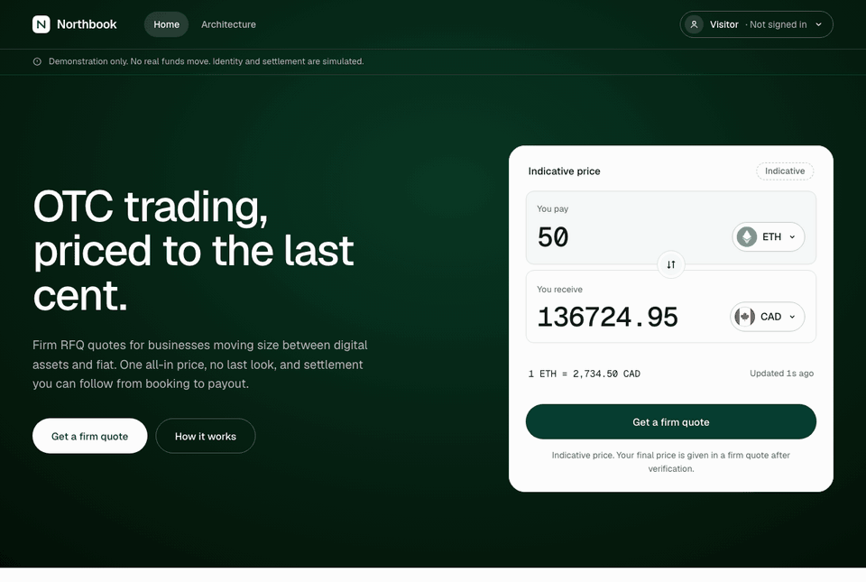

## From requirement to running code

| Stage | Artifact | Where |
| --- | --- | --- |
| Requirements | Behaviour specs with WHEN/THEN scenarios | [`openspec/changes/demo-slice/specs/`](openspec/changes/demo-slice/specs/) |
| Design | Recorded decisions with trade-offs | [`design.md`](openspec/changes/demo-slice/design.md) |
| Plan | Ordered tasks, each with its own verification | [`tasks.md`](openspec/changes/demo-slice/tasks.md) |
| Implementation | TypeScript across web, API and shared packages | `apps/`, `packages/` |
| Verification | Unit, integration and browser tests | `pnpm test`, `pnpm test:e2e` |

## What it does

| Area | Behaviour |
| --- | --- |
| Public price | Anyone sees an indicative BTC, ETH, USDC or USDT price in CAD or USD, streamed live. |
| Onboarding (KYB) | A business submits an application; staff approve or reject it. Only approved businesses get firm quotes. |
| Firm quote (RFQ) | An all-in price for an exact amount, valid for a short configurable time, with expiry enforced by the server. |
| Acceptance | At most one trade per quote, at exactly the quoted price, however many times the request arrives. |
| Settlement | Staff move the trade through funds received, payout sent and settled. Bank and chain events are simulated. |
| Ledger | Every financial step posts balanced double-entry transactions that can never be edited. |
| Staff console | Approvals, a blotter of all quotes and trades with route and spread, the desk's position and spread revenue, and pricing configuration. |

## System overview

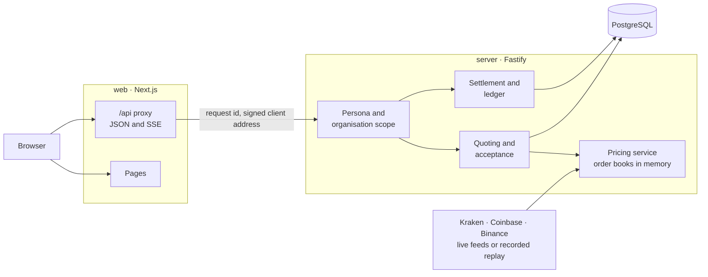

- **Two processes.** The browser only ever talks to `web`. `web` forwards `/api` to `server` over a private network, so `server` is never public.
- **One database.** PostgreSQL holds quotes, trades, state events, the ledger, idempotency keys and rate limits. There is no cache or queue to keep consistent with it.
- **Two database roles.** The owner role runs migrations and seed. Requests run as a restricted role that cannot alter schema or rewrite ledger rows.
- **Shared package.** Schemas, decimal money rules and the state-machine transition tables are written once in TypeScript and used by both `web` and `server`.

## Trade flow

Selling 50 ETH for CAD, from price to settled:

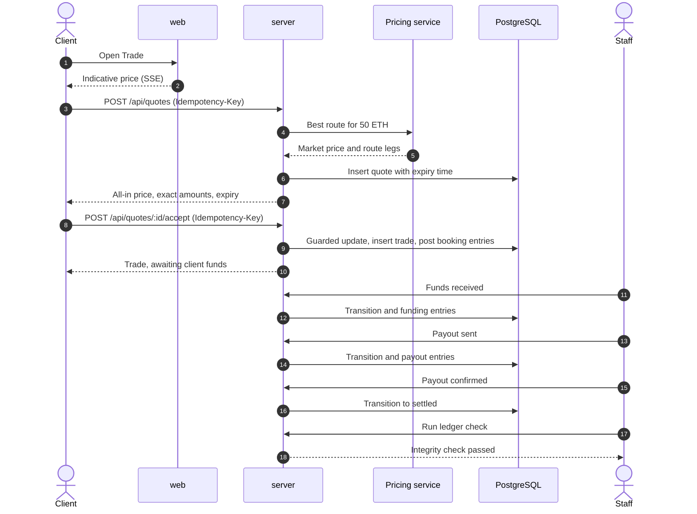

Steps 8 and 9 run in one database transaction, as does each later transition with its ledger entries: a trade cannot exist without its postings, and postings cannot exist without the state change.

## How a price is built

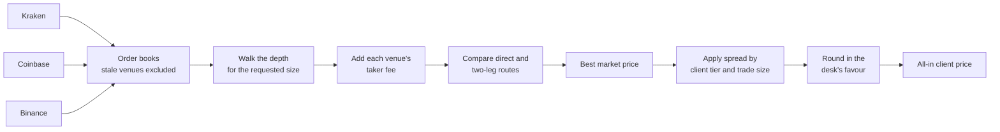

- **Depth, not top of book.** The price for 50 ETH is the volume-weighted cost of filling 50 ETH, not the best bid.
- **Two-leg routes.** Not every venue lists CAD pairs, so ETH/CAD can be priced as ETH/USD then USD/CAD and compared with the direct market.
- **Spread.** Configured in basis points per client tier and size band. The client sees only the all-in price; staff see the route, the market price and the spread.
- **Guardrails.** No quote is issued if market data is stale or if the client price would be better than the market price.
- **Replay mode.** The default runs the same adapters against recorded venue data, so the demo behaves the same anywhere and tests are deterministic.

## Exactly one trade per quote

A firm quote is a promise, so acceptance must be safe against double clicks, retries and races. Three layers enforce it:

1. **Idempotency key.** Every state-changing request carries an `Idempotency-Key`. A repeat with the same body returns the stored response; the same key with a different body is refused as a conflict.
2. **Guarded update.** Acceptance is a single statement that only succeeds while the quote is still valid by database time:

   ```sql
   UPDATE quotes SET status = 'accepted'
   WHERE id = $1 AND status = 'active' AND expires_at > now();
   ```

   Of any number of concurrent acceptances, one row update wins. The others find the existing trade and return it.
3. **Unique constraint.** `trades.quote_id` is unique, so a second trade for the same quote cannot be stored even if application code were wrong.

The browser disables Accept just before expiry and on first click, but that is convenience only. The server decides.

## State machines

Transitions are defined as data in the shared package. The server refuses anything not in the table, and the diagrams on the Architecture page are generated from the same tables at build time.

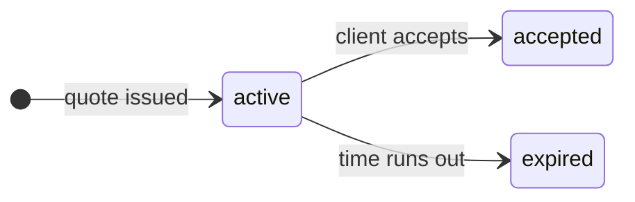

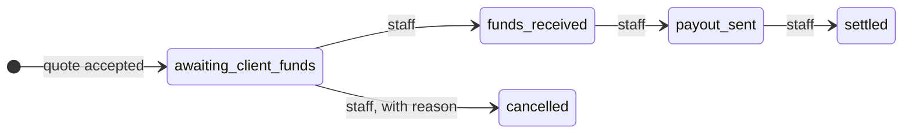

KYB applications follow `draft → submitted → approved | rejected`. Every transition is stored with its time and actor, and repeating one has no further effect.

## Ledger

Each step of a trade posts one balanced transaction. For a client selling ETH for CAD:

| Step | Debit | Credit |
| --- | --- | --- |
| Trade booked | Client receivable (ETH), trading position (CAD) | Trading position (ETH), client payable (CAD), spread revenue (CAD) |
| Funds received | Desk wallet (ETH) | Client receivable (ETH) |
| Payout sent | Client payable (CAD) | Desk bank (CAD) |
| Cancelled before funding | Reverses the booking entries | |

- Debits equal credits **per currency** in every transaction, enforced by a database constraint, not only by application code.
- Entries are insert-only. Corrections are new reversing entries.
- Amounts are stored as exact decimals and never pass through floating point.
- Staff can run an integrity check that re-verifies the whole ledger.

## Technology

| Layer | Choice |
| --- | --- |
| Web | Next.js, React, TypeScript |
| API | Node.js, Fastify, Zod |
| Data | PostgreSQL, Drizzle ORM |
| Live updates | Server-sent events |
| Tests | Vitest, fast-check, Playwright |
| Repository | pnpm workspace: `apps/web`, `apps/server`, `packages/shared` |

## What is real and what is simulated

| Real | Simulated | Out of scope |
| --- | --- | --- |
| Price aggregation and routing | Bank and blockchain confirmations | Production login and user management |
| Quote expiry and idempotent acceptance | Identity verification | Real custody and payments |
| State machines and ledger | Personas instead of accounts | Hedging the desk's position |

## Screens

| Trading | Staff settlement and ledger |
| --- | --- |
| 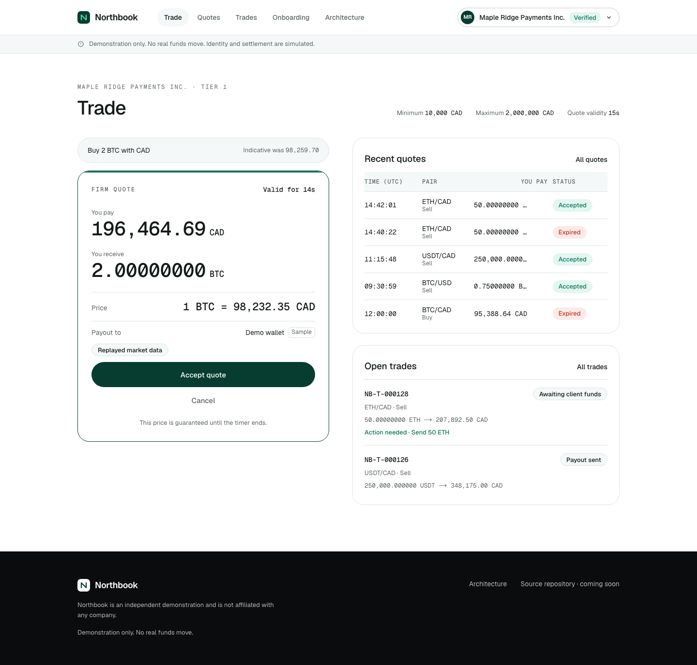 | 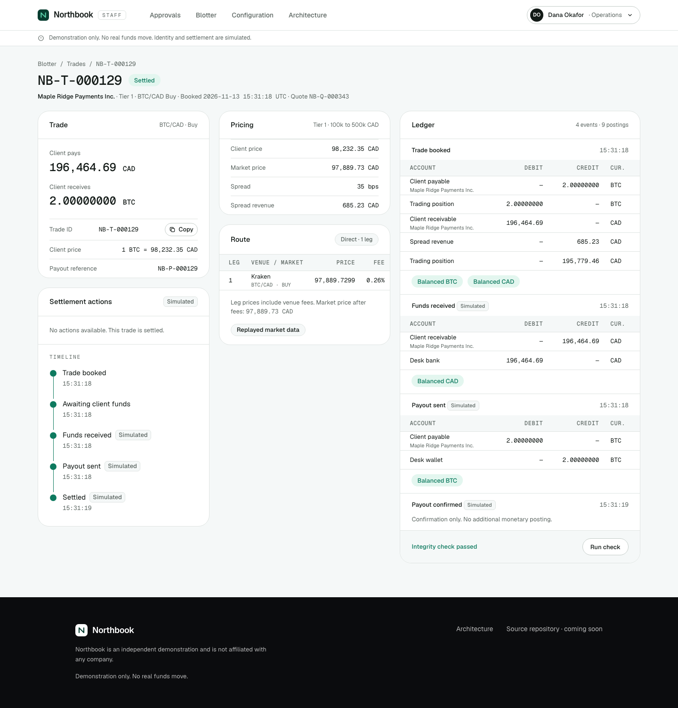 |
| 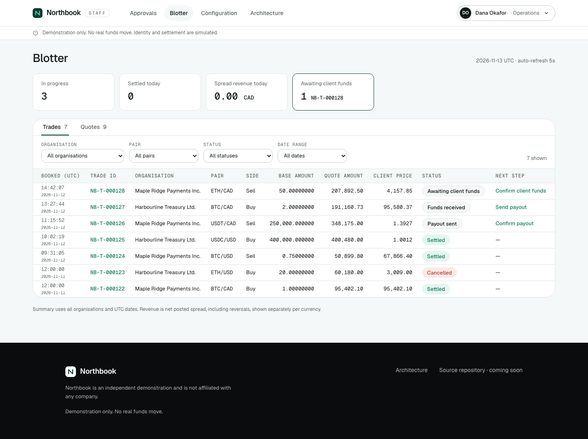 | 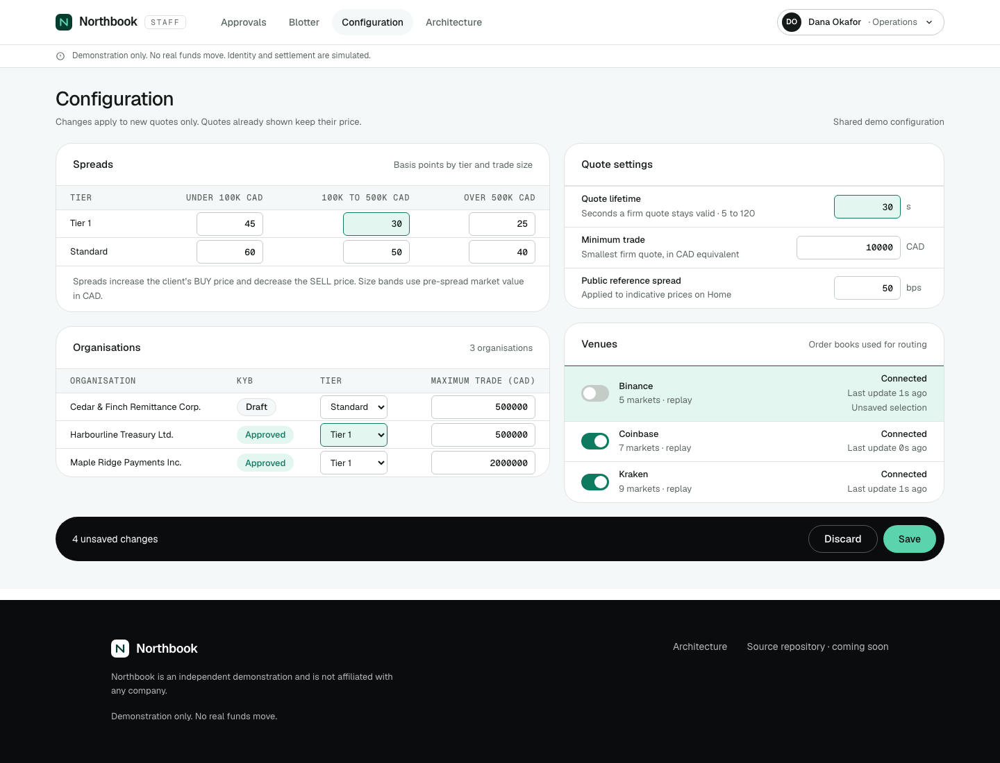 |
| 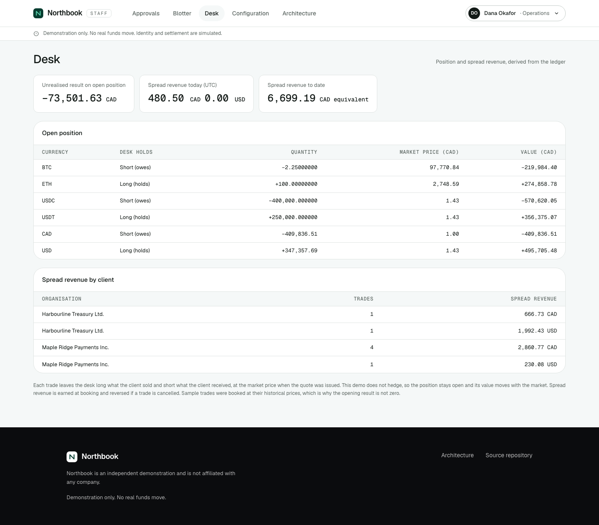 | |

The browser tests capture every screen, including phone layouts, into `docs/review/` when they run.

## Run locally

Prerequisites: Node.js 24 or newer, pnpm 11.17.0 and Docker with Compose.

```sh
pnpm install --frozen-lockfile
pnpm dev
```

`pnpm dev` creates a local `.env` if there is none, starts PostgreSQL, applies migrations, seeds sample data and starts both applications. Everything you do is kept; `pnpm db:reset` restores the sample data. Open [http://127.0.0.1:3000](http://127.0.0.1:3000).

Recorded market data is the default. For live venue feeds:

```sh
PRICING_MODE=live pnpm dev
```

## Five-minute walkthrough

1. Choose **Maple Ridge Payments** in the persona switcher and open **Trade**.
2. Sell 50 ETH for CAD: **Get quote**, then **Accept quote** before the countdown ends.
3. **View trade** shows Awaiting client funds with sample settlement instructions.
4. Switch to **Northbook staff**, open the trade in the **Blotter** and run the three simulated settlement steps until it is Settled.
5. In the trade's **Ledger**, choose **Run check**.

To see onboarding, choose **Cedar & Finch**, submit the application, then approve it as staff under **Approvals**.

## Tests

```sh
pnpm lint
pnpm typecheck
pnpm test
E2E_PRODUCTION=1 pnpm test:e2e
```

Unit and integration tests cover decimal rounding, depth and routing, stale venue exclusion, idempotency, concurrent acceptance, expiry, KYB, ledger balance and immutability. Browser tests run both settlement directions end to end in replay mode. Run the two database-backed suites one after the other, not in parallel.

## Further reading

- The in-app **Architecture** page (`/architecture`) explains the same design with generated diagrams.
- [Blueprint](docs/blueprint/): the fuller production design this demo is a slice of, including real settlement, chain monitoring and reconciliation. It is a plan and is not implemented here.
- [Proposal](openspec/changes/demo-slice/proposal.md), [design decisions](openspec/changes/demo-slice/design.md) and [behaviour specs](openspec/changes/demo-slice/specs/) define the scope.

Licensed under the [MIT licence](LICENSE).
